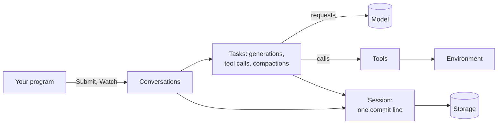

<div align="center">

# pi-durable-go

**Durable AI agents for Go.**

Conversations, tool calls, and long-running tasks that survive crashes,
restarts, and deploys. A Go port of
[Pi Durable](https://github.com/earendil-works/pi/tree/v1.5.2/packages/durable),
checked against upstream's own code.

[](https://github.com/leocavalcante/pi-durable-go/actions/workflows/ci.yml)
[](https://github.com/leocavalcante/pi-durable-go/actions/workflows/crosscheck.yml)
[](https://pkg.go.dev/github.com/leocavalcante/pi-durable-go)
[](https://goreportcard.com/report/github.com/leocavalcante/pi-durable-go)
[](https://github.com/leocavalcante/pi-durable-go/releases)
[](LICENSE)

[Getting started](docs/getting-started.md) ·
[Documentation](docs/README.md) ·
[Examples](examples) ·
[Compatibility](COMPATIBILITY.md) ·
[Changelog](CHANGELOG.md)

</div>

---

Agents fail halfway. A pod is rescheduled during a tool call, a provider times
out on the third retry, a deploy lands in the middle of a conversation.
**pi-durable-go commits every step of an agent's work before anyone sees it**,
so the next process opens the same storage and carries on exactly where the
last one stopped:

```console
$ go run ./examples/recovery -crash
  step 1: running
  step 1: done
  step 2: running
  step 2: the process dies here
$ go run ./examples/recovery
  step 2: running
  step 2: done
  step 3: running
  step 3: done
job 2: done
```

## Highlights

- **Crash-proof by construction.** Conversations, tasks, and your own state
  change in commits on one serialized line, and storage accepts each commit
  before any reader sees it. Interrupted tasks resume from their checkpoints,
  interrupted model requests count as failed attempts and retry, and
  replay-safe tools run again.
- **The agent loop, done for you.** Steering and follow-up queues, parallel
  tool rounds with nested calls and structured output, retries with backoff,
  automatic compaction of long contexts, hooks, prompt sections, forks, and a
  live view of every run.
- **Models included.** `model.OpenAI` streams Chat Completions in pure Go and
  knows pi-ai's catalog of 728 models; `model.Pi` reaches every provider pi-ai
  supports, with Pi's `/login` credentials. Or bring your own: it is one
  method.
- **Tools included.** Upstream's coding tools (`read`, `write`, `edit`, `bash`,
  `powershell`, `tool_search`) over a local environment that answers as
  upstream's Node environment does, error messages and file watching included.
- **Code mode.** Models write JavaScript that calls your tools, in a QuickJS
  sandbox that runs in pure Go, and the script survives a restart by
  deterministic replay.
- **Storage in pure Go.** Memory, JSONL, or SQLite without CGO, with bounded
  memory for long-lived sessions and a conformance suite for your own backend.
- **Checked against upstream.** 118 whole conversations replay through this
  Harness and through upstream's TypeScript, next to thousands of smaller
  comparisons, on every pull request.

## Quick start

```sh
go get github.com/leocavalcante/pi-durable-go
```

A durable coding agent on SQLite ([examples/quickstart](examples/quickstart/main.go)):

```go
package main

import (
	"context"
	"fmt"
	"log"
	"os"

	durable "github.com/leocavalcante/pi-durable-go"
	"github.com/leocavalcante/pi-durable-go/model"
	"github.com/leocavalcante/pi-durable-go/storage"
	"github.com/leocavalcante/pi-durable-go/tools"
)

func main() {
	ctx := context.Background()

	// Any of pi-ai's 728 OpenAI-compatible models, configured as pi-ai does.
	llm, _ := model.OpenAIModel("groq", "llama-3.3-70b-versatile")
	llm.APIKey = os.Getenv("GROQ_API_KEY")

	// The coding tools: read, write, edit, and bash. A directory is not a sandbox!
	registry := durable.NewRegistry()
	if err := registry.Install(tools.Coding()); err != nil {
		log.Fatal(err)
	}

	// Every step is committed to SQLite before anyone sees it.
	store, err := storage.OpenSQLite(ctx, "agent.sqlite")
	if err != nil {
		log.Fatal(err)
	}
	h, err := durable.Open(ctx, store, durable.HarnessOptions{
		Model:    llm,
		Registry: registry,
		Environment: func(durable.ConversationRecord) (durable.ExecutionEnv, error) {
			return tools.NewLocalEnv(".")
		},
	})
	if err != nil {
		log.Fatal(err)
	}
	defer h.Close(ctx)
	h.Resume() // finish whatever a previous run left unfinished

	agent, err := h.Root(ctx, durable.ConversationOptions{Agent: durable.Agent{
		Model: durable.ModelRef{Provider: "groq", ID: "llama-3.3-70b-versatile"},
	}})
	if err != nil {
		log.Fatal(err)
	}

	// The request ID admits the task once, even across restarts.
	task, err := agent.Submit(ctx, durable.SubmissionRequest{
		Content:   "Which Go packages does this directory have?",
		RequestID: "inventory-1",
	})
	if err != nil {
		log.Fatal(err)
	}
	result, err := task.Wait(ctx)
	if err != nil {
		log.Fatal(err)
	}

	entries, err := agent.Entries(ctx)
	if err != nil {
		log.Fatal(err)
	}
	for _, entry := range entries {
		if entry.ID == result.Answer {
			fmt.Println(entry.Message.Content)
		}
	}
}
```

Kill it halfway and run it again: it picks up the same task. No key at hand?
`go run ./examples/basic` runs with a model that echoes, and
`go run ./examples/recovery -crash` shows a crash and its recovery offline.

## How it works



A **Harness** runs **conversations**, durable transcripts of entries. Each run
is a chain of **tasks** (a generation per turn, a task per tool call), which
the scheduler runs from their checkpoints. Every change goes through the
**Session**'s single commit line into **storage**, so whatever anyone saw is
what a restart finds. [Concepts](docs/concepts.md) has the whole picture.

## Examples

| Example | What it shows |
|---|---|
| [basic](examples/basic/main.go) | A first conversation, with an echoing model and no keys |
| [recovery](examples/recovery/main.go) | A job that survives a crash in the middle of a tool call |
| [quickstart](examples/quickstart/main.go) | A coding agent on SQLite, with a model from the catalog |
| [chat](examples/chat/main.go) | A command-line chat with Pi's credentials or any OpenAI-compatible API, and optional coding tools |

## Documentation

- [Getting started](docs/getting-started.md) and [concepts](docs/concepts.md)
- Guides: [conversations](docs/guides/conversations.md),
  [persistence and recovery](docs/guides/persistence-and-recovery.md),
  [retries and compaction](docs/guides/retries-and-compaction.md),
  [tasks and documents](docs/guides/tasks.md),
  [tools and models](docs/guides/tools-and-models.md),
  [the execution environment](docs/guides/execution-environment.md),
  [code mode](docs/guides/code-mode.md)
- [API reference](https://pkg.go.dev/github.com/leocavalcante/pi-durable-go),
  [safety and limits](docs/safety.md), [upgrading](docs/upgrading.md)

## Compatibility and status

pi-durable-go follows upstream Pi Durable **v1.5.2**. Upstream's behavior
decides the port's, and `make crosscheck` runs upstream's TypeScript on the
same inputs to prove it ([how](docs/upstream-cross-checks.md)). Where Go
differs on purpose, or where something is not ported yet,
[COMPATIBILITY.md](COMPATIBILITY.md) says so.

It is **pre-1.0**: minor versions may change the API, and the changelog marks
every breaking change. It needs Go 1.26 or newer. CI runs the whole test suite on
Linux and macOS; on Windows the module builds and the model adapters and code
mode are tested, while JSONL storage and the local shell are POSIX-only.

## Contributing

Issues and pull requests are welcome; see [CONTRIBUTING.md](CONTRIBUTING.md)
and the [code of conduct](CODE_OF_CONDUCT.md). Please report vulnerabilities
privately, as [SECURITY.md](SECURITY.md) explains.

## License

[MIT](LICENSE), the same as Pi. pi-durable-go is an independent port of
[Pi](https://github.com/earendil-works/pi) by Mario Zechner and is not an
official Earendil project; [NOTICE](NOTICE) has the attribution and
[DEPENDENCIES.md](DEPENDENCIES.md) the licenses of what it uses.
