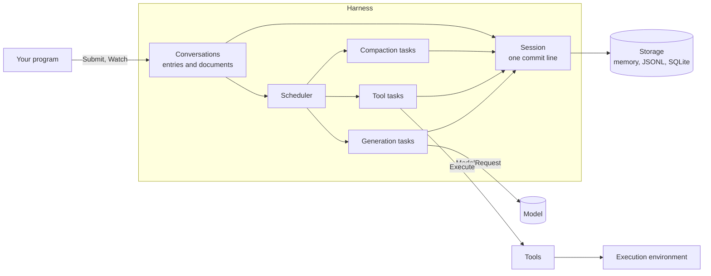

# Concepts

pi-durable-go is a runtime for agents whose every step is durable. This page
names its parts and shows how they fit; the [guides](README.md#guides) cover
each in depth.

## The Harness and its Session

A **Harness** is the runtime: it owns one **Session**, a scheduler, and a
registry of extensions. The Session is the only way state changes. Every
change is a **commit** on one serialized line: storage accepts it before any
reader, watcher, or task sees it. If storage fails, the Session fails and
closes; reopening the storage reads the durable truth.

One Session owns a storage at a time. Opening the same storage again, after a
crash or a deploy, picks up all of its work.

## Conversations, entries, and runs

A **conversation** is a durable transcript of **entries**: the user's input,
the system prompt and tools as each request saw them, the model's answers,
tool results, and entries of your own kinds. Conversations fork at any entry,
and each has its **agent**: the model, thinking level, tools, and prompt
sections it uses.

A **submission** asks a conversation to act: `input` starts or joins a run,
`write` appends an entry, `continue` resumes after a failed run. A **run**
answers its inputs through generations and tool rounds; the submission
settles when the run has answered, or failed to. Request IDs make submissions
idempotent. See [conversations and runs](guides/conversations.md).

## Tasks

The work of a run happens in **tasks**: checkpointed state machines the
scheduler runs, not goroutines that a crash loses. A generation is a task, as
are each tool call and each compaction, and applications define their own.
A task records each phase's checkpoint before it moves on, so after a crash
the next process continues from the last one. Tasks own other tasks and
conversations, and an abort reaches everything below it. See
[tasks](guides/tasks.md).

## Documents

**Documents** are typed JSON state with a scope (a conversation, a task, or
the session), a history (latest, or rewindable to any entry), and a fork
policy. Every conversation starts with built-in ones: `pi.live` (the run as it
goes), `pi.inbox` (queued inputs), `pi.usage` (tokens and cost), `pi.provider`,
and `pi.agent`. Applications keep their own state in documents, committed
together with the transcript.

## Models, tools, and environments

A **model** answers requests (`durable.Model`): `model.OpenAI` in pure Go,
`model.Pi` through an installed Pi, or your own. **Tools** run as tasks, with
their arguments checked against their schemas, and reach files and processes
through the conversation's **execution environment**. **Extensions** bundle
tools, prompt sections, hooks, and task definitions, installed in the
registry. See [tools and models](guides/tools-and-models.md) and the
[execution environment](guides/execution-environment.md).

## What durability promises

- **Committed state survives.** Whatever a commit stored is there after a
  crash, and nothing uncommitted was ever shown.
- **Interrupted work continues.** Tasks resume from their checkpoints; a
  model request in flight is retried as a failed attempt; a replay-safe tool
  runs again.
- **External effects are not exactly-once.** A crash between an effect and
  the commit that records it leaves uncertainty. Use idempotency keys,
  receipts, or reconciliation for effects that matter; see
  [persistence and recovery](guides/persistence-and-recovery.md#external-effects).

## Where it comes from

pi-durable-go is a Go port of upstream
[Pi Durable](https://github.com/earendil-works/pi/tree/v1.5.2/packages/durable),
the durable harness of the [Pi](https://github.com/earendil-works/pi) coding
agent. It follows upstream's behavior and checks itself against upstream's own
code ([upstream cross-checks](upstream-cross-checks.md));
[COMPATIBILITY.md](../COMPATIBILITY.md) lists what differs.
